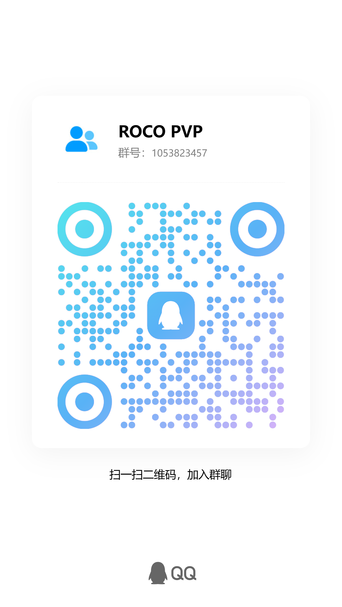

# 洛克 PVP 辅助工具

**让对战信息更清楚，让每次决策更有依据。**

面向《洛克王国：世界》的个人辅助工具。
你可以在游戏旁查看战况与技能伤害。
你也可以结合观测信息判断敌方配置。
项目以PVP为主，也提供大世界辅助功能。

[国内下载 · CNB](https://cnb.cool/sduwcgg/roco-pvp) · [GitHub下载](https://github.com/sduwcdd/RoCo-PVP/releases/latest) · [加入QQ群](#交流与反馈) · [自愿打赏](#支持项目)

## 能帮你做什么

|功能|用途|
|---|---|
|实时战况面板|查看双方精灵、生命、能量和状态。 悬浮面板支持拖动与收起。|
|技能伤害估计|查看最低、参考及最高伤害。 区分应对、出手条件和连击。|
|备战伤害试算|点击己方备战精灵。 查看四个技能对当前敌方的伤害。|
|六维与配置推断|结合已知面板、伤害和出手顺序。 缩小敌方属性与加点的可能范围。|
|敌方技能查询|查询敌方精灵可以携带的技能。 点击技能查看当前条件下的伤害。|
|本局回合记录|回看双方技能、换人与具体伤害。 对局记录自动保存在本地。|
|大世界精灵辅助|筛选附近精灵并手动刷新。 查看已获取的性格、特长及身体信息。|
|奖牌条件提示|查看身高、体重与声音相关提示。 区分预计奖牌与已确认奖牌。|

具体功能以所用安装包为准。
游戏更新后，部分规则可能需要适配。

## 下载与使用

优先使用[CNB国内下载](https://cnb.cool/sduwcgg/roco-pvp)。
也可使用[GitHub Releases](https://github.com/sduwcdd/RoCo-PVP/releases/latest)。
请下载适合自己设备的安装包。

### Windows

1. 下载并安装Windows安装包。
2. 首次使用需安装[Npcap](https://npcap.com/#download)。
3. 打开APP，连接服务并启动抓包。
4. 按提示授予采集所需的管理员权限。
5. 重新登录游戏，再显示悬浮面板。

APP内提供版本检查与下载安装入口。
关闭主窗口会收起到托盘。
彻底退出请右键点击托盘图标。

### 手机

Android目前提供内测版本。
你可以在同一台手机运行游戏和辅助APP。
请按APP提示开启采集与悬浮窗权限。
手机适配情况仍需结合设备实测。

iOS目前没有可安装的正式版本。

## 关于估计结果

工具提供信息辅助。
你仍需自行选择技能和换人。

伤害估计会考虑已接入的状态与规则。
未知技能和未确认配置会保留范围。
中途观战可能缺少此前的累计信息。
预测结果不等于游戏实际结算。

## 数据来源

精灵图鉴、技能及特性资料来源于BWIKI。
你可以访问[洛克王国世界WIKI](https://wiki.biligame.com/nrc/%E9%A6%96%E9%A1%B5)。
感谢BWIKI及各位资料贡献者。
伤害估计还结合了对局观测与实战校准。
本项目不代表BWIKI或游戏官方。

## 交流与反馈

**QQ群：1053823457**

欢迎交流使用体验、反馈问题和提出建议。
反馈伤害问题时，请附上版本号。
同时说明双方精灵、技能与回合。
如能提供对局记录，会更方便排查。

扫描下方二维码加入 **ROCO PVP** 群。
二维码失效时，可搜索QQ群号加入。

## 支持项目

本项目由个人利用业余时间维护。
如果工具帮到了你，欢迎自愿打赏。
你的支持会鼓励我继续修复和适配。

**打赏完全自愿，金额随心。**
不打赏也不影响正常使用。
你也可以通过反馈问题来支持项目。

下方是作者的**微信收款码**。
感谢每一位愿意支持项目的朋友。

点击二维码图片可查看原图。

---

本项目为个人兴趣项目。
本项目与游戏官方无隶属关系。
